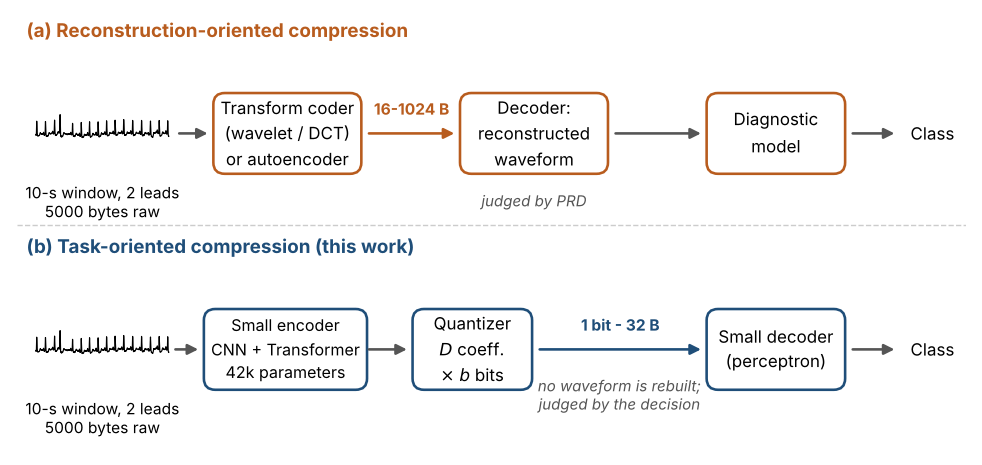
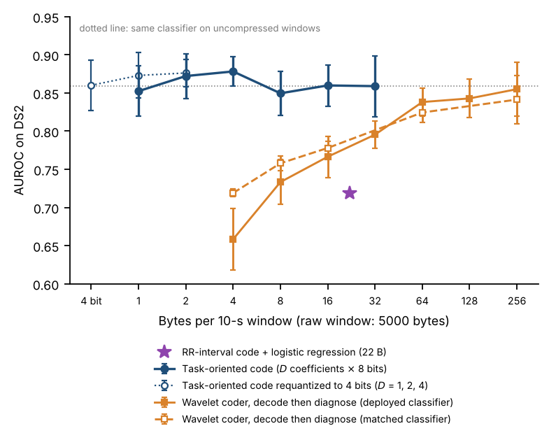
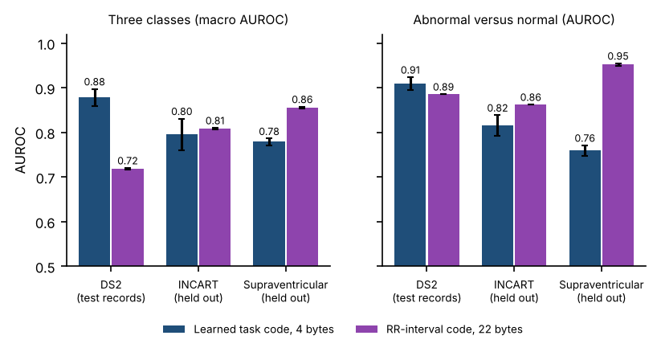

# How many bytes does an arrhythmia decision need?

**Task-oriented compression of wearable ECG.** Code, results and figures for the manuscript of the same name (under review).

A wearable ECG patch normally sends the waveform, or a compressed version of it, and a computer at the other end decides whether the rhythm is abnormal. This project asks a narrower question: if the receiver only needs the *decision*, how few bytes can the patch send?



## Main results

All numbers are AUROC on the 22 DS2 test records of the MIT-BIH Arrhythmia Database, which are never used for training or calibration. The task is the three-class AAMI decision for each 10-second window: normal, supraventricular ectopy, ventricular ectopy.

| Code sent per 10-s window (raw window: 5000 bytes) | AUROC |
|---|---|
| Task-oriented code, **4 bytes** | **0.878 ± 0.019** |
| Task-oriented code, 1 byte | 0.852 ± 0.033 |
| Task-oriented code, 32 bytes | 0.859 ± 0.040 |
| Wavelet coder, 4 bytes, decode then classify | 0.719 ± 0.005 |
| Wavelet coder, 16 bytes, decode then classify | 0.778 ± 0.009 |
| Wavelet coder, 256 bytes, decode then classify | 0.855 ± 0.035 |
| Hand-crafted RR-interval code, 22 bytes | 0.718 ± 0.002 |



- **The encoder is tiny:** 3,163 parameters and 0.59 million multiply-accumulate operations per window.
- **Training data matters most:** the same 4-byte codec trained on DS1 only (22 records) reaches 0.790; trained on three databases (171 records) it reaches 0.878.
- **A wavelet compressor needs about 256 bytes** to support the same decision after decoding.

### What the learned code does *not* do better

These results are reported in the paper and matter for anyone building on this work.

- With one database held out of training, the 4-byte code reaches 0.796 on St Petersburg INCART and 0.779 on the MIT-BIH Supraventricular Arrhythmia Database.
- For the simple abnormal-versus-normal question, a hand-crafted RR-interval code is better than the learned code on both held-out databases (0.862 vs 0.816 on INCART; 0.952 vs 0.759 on the Supraventricular database).
- All results are computational. Nothing was measured on hardware.



## Repository layout

```
experiments/   all code: data caches, models, training runners, evaluation, figures
results/       result files behind every number in the paper (no raw data, no model weights)
figures/       figures used in this README and in the paper
```

| File in `results/` | Contents |
|---|---|
| `per_seed_results.json` | metrics of all 288 training runs (49 configurations), one entry per seed |
| `new_eval2.json` | three-database experiments: code-size sweep, wavelet coder, leave-one-database-out, paired tests |
| `new_eval.json` | DS1-only experiments: wavelet/DCT coder, zero-shot external tests, autoencoders |
| `analysis_ds1_only.json` | DS1-only tables (Transformer encoder, ablations, quantization) |
| `classic_prd.json` | reconstruction error of the wavelet and DCT coders per byte budget |

## Reproduce

Requirements: Python 3.10 or newer, about 2 GB of disk for the data, and 6 to 8 CPU-hours on two cores (no GPU needed).

```bash
git clone https://github.com/azzawi91/task-oriented-semantic-ecg.git
cd task-oriented-semantic-ecg
pip install -r requirements.txt
cd experiments
bash run_all.sh
```

`run_all.sh` downloads the three open PhysioNet databases, builds the window caches, trains every configuration, and writes the tables and figures to `experiments/work/paper/`. Every step is resumable. See [`experiments/README.md`](experiments/README.md) for what each script does and how to run a single experiment.

Exact numbers depend on the PyTorch version and CPU; the published numbers were produced with PyTorch 2.15 (CPU). Expect differences in the third decimal.

## Data

No data are stored in this repository. All four databases are public on [PhysioNet](https://physionet.org): MIT-BIH Arrhythmia Database, MIT-BIH Supraventricular Arrhythmia Database, St Petersburg INCART 12-lead Arrhythmia Database, and PTB-XL.

## Citation

See `CITATION.cff`. The manuscript is under review; the citation will be updated when it is published.

## License

MIT (see `LICENSE`).
