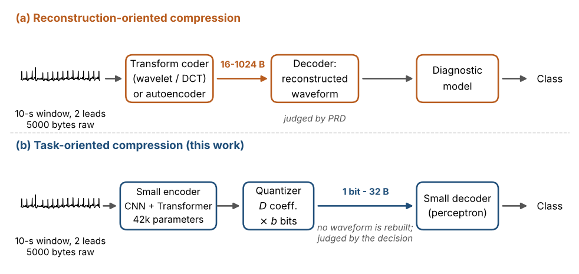
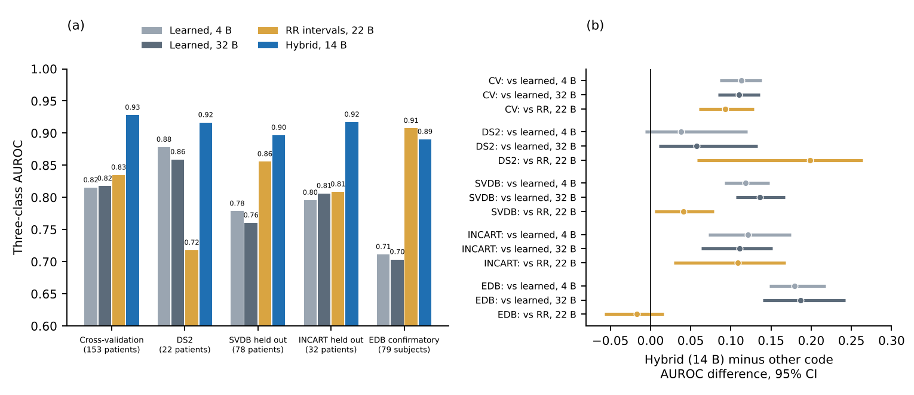
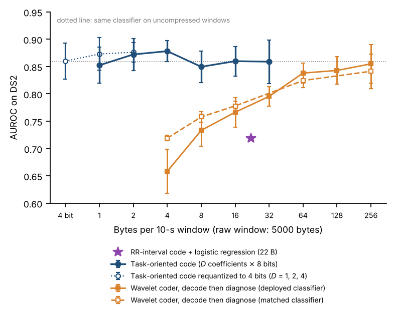

# Ten rhythm bytes outperform twenty-eight learned ones

**Content, not size, limits compact ECG codes on unseen patients.** Code, results and figures for the manuscript "Ten Rhythm Bytes Outperform Twenty-Eight Learned Ones in Compact ECG Codes".

A wearable ECG patch normally sends the waveform, or a compressed version of it, and a computer at the other end decides whether the rhythm is abnormal. If the receiver only needs the *decision*, the patch can send a code of a few bytes instead. This project asks what limits such a code on patients and databases it has never seen: how many bytes it has, or what the bytes hold.



## Main results

The task is the three-class AAMI decision for each 10-second, two-lead window: normal, supraventricular ectopy, ventricular ectopy. Numbers are macro-averaged AUROC. Differences are paired, with bootstrap 95% intervals over test patients and training runs.

**More learned bytes add nothing. Ten bytes of RR-interval statistics add about 0.11.**

| Evaluation | Learned, 4 B | Learned, 32 B | RR intervals, 22 B | Hybrid, 14 B (4 learned + 10 RR) | Hybrid minus learned 32 B |
|---|---|---|---|---|---|
| 10 x 5-fold cross-validation, 153 patients | 0.815 | 0.818 | 0.835 | **0.928** | +0.110 (+0.084 to +0.136) |
| DS2 of MIT-BIH Arrhythmia, 22 patients | 0.878 | 0.859 | 0.718 | **0.916** | +0.058 (+0.011 to +0.133) |
| MIT-BIH Supraventricular, held out of training, 78 patients | 0.779 | 0.760 | 0.856 | **0.897** | +0.136 (+0.106 to +0.168) |
| St Petersburg INCART, held out of training, 32 patients | 0.796 | 0.806 | 0.809 | **0.917** | +0.111 (+0.064 to +0.151) |
| European ST-T, pre-specified confirmatory test, 79 subjects | 0.711 | 0.703 | 0.908 | 0.890 | +0.187 (+0.140 to +0.242) |



- **Code size:** in cross-validation the 4-byte code differs from the 32-byte code by -0.003 (-0.015 to +0.011). One byte is lower by 0.028.
- **Confirmatory test:** the comparison on the European ST-T Database was fixed in [`CONFIRMATION_PLAN.md`](CONFIRMATION_PLAN.md) before that database was downloaded, and was run once.
- **Evaluation protocol:** letting windows of the test patients into training raises the AUROC by 0.061 (+0.002 to +0.102). That gain is an artefact of the protocol.
- **Encoder:** 3,163 parameters and 0.59 million multiply-accumulate operations per window. A Transformer encoder with 19 times the computation changes the AUROC by -0.012 (-0.046 to +0.029).
- **Reconstruction coding:** a wavelet coder with a classifier retrained on its output is still 0.054 below the 4-byte code at 64 bytes.



### What the results do *not* show

- On the European ST-T Database, whose lead pairs differ from the training data, the hybrid code only equals the RR-interval code alone (-0.017, -0.058 to +0.016). The learned bytes add nothing detectable there.
- For the abnormal-versus-normal question on the held-out Supraventricular database, the RR-interval code alone is better than the hybrid (0.952 vs 0.907).
- With the number of training steps held equal, 171 training records instead of 18 give +0.066 (-0.021 to +0.147) on DS2. A benefit of the larger training set is not established for patients whose database is already represented.
- All results are computational. Nothing was measured on hardware.

## Repository layout

```
experiments/   all code: data caches, models, training runners, evaluation, figures
results/       result files behind every number in the paper (no raw data, no model weights)
figures/       figures used in this README and in the paper
```

| File in `results/` | Contents |
|---|---|
| `paired_bootstrap_stats.json` | every paired difference reported in the paper: both means, difference, 95% and 90% intervals, p-value, number of runs and of patients |
| `per_seed_results_v4.json` | metrics of the later runs: extra Transformer seeds, record-mixed control, matched-size training sets, repeated cross-validation |
| `per_seed_results.json` | metrics of all 288 training runs (49 configurations), one entry per seed |
| `new_eval2.json` | three-database experiments: code-size sweep, wavelet coder, leave-one-database-out, paired tests |
| `new_eval.json` | DS1-only experiments: wavelet/DCT coder, zero-shot external tests, autoencoders |
| `analysis_ds1_only.json` | DS1-only tables (Transformer encoder, ablations, quantization) |
| `classic_prd.json` | reconstruction error of the wavelet and DCT coders per byte budget |

## Reproduce

Requirements: Python 3.10 or newer, about 2.5 GB of disk for the data, and about 20 CPU-hours on two cores for everything (no GPU needed). `run_all.sh` covers the first 6 to 8 hours; the later experiments are listed in `experiments/README.md`.

```bash
git clone https://github.com/azzawi91/task-oriented-semantic-ecg.git
cd task-oriented-semantic-ecg
pip install -r requirements.txt
cd experiments
bash run_all.sh
```

`run_all.sh` downloads the three open PhysioNet databases, builds the window caches, trains every configuration, and writes the tables and figures to `experiments/work/paper/`. Every step is resumable. See [`experiments/README.md`](experiments/README.md) for what each script does and how to run a single experiment.

Exact numbers depend on the PyTorch version and CPU; the published numbers were produced with PyTorch 2.15 (CPU). Expect differences in the third decimal.

## Data

No data are stored in this repository. All five databases are public on [PhysioNet](https://physionet.org): MIT-BIH Arrhythmia Database, MIT-BIH Supraventricular Arrhythmia Database, St Petersburg INCART 12-lead Arrhythmia Database, European ST-T Database, and PTB-XL.

## Citation

See `CITATION.cff`. The citation will be updated when the paper is published.

## License

MIT (see `LICENSE`).
